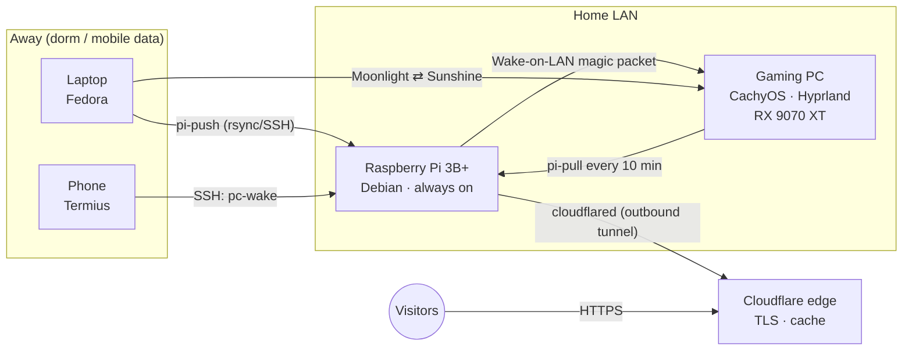

# homelab

A laptop, a Raspberry Pi and a gaming PC, glued together with WireGuard, rsync and systemd.

From anywhere with an internet connection (in my case a dorm room on a phone hotspot) I can:

- **push files** from the laptop to the home PC, even while the PC is switched off;
- **wake the PC**, wait until it is ready, and **stream games** from it at 1080p60;
- **SSH** into every machine from the laptop or a phone;
- **host my portfolio site** ([zlgeri.com](https://zlgeri.com)) on the Pi, over HTTPS, without opening a single port on the home router.

## Architecture



All device-to-device traffic runs over a [NetBird](https://netbird.io) mesh (WireGuard). Peers connect
peer-to-peer when NAT traversal succeeds and fall back to a relay when it doesn't.

## Design principles

- **Outbound only.** Nothing listens on the public internet. The VPN mesh and the Cloudflare Tunnel both
  dial out, so the home router needs no port forwarding and its make or model doesn't matter.
- **Least exposure.** SSH accepts keys only, everywhere. On the PC, the firewall opens SSH and Sunshine
  only on the VPN interface (`wt0`); the Sunshine admin UI is not exposed at all (reach it through an SSH tunnel).
- **Store and forward.** The PC is usually off, so the always-on Pi acts as a mailbox. The laptop pushes
  when *I* decide (like `git push`), and the PC pulls on a timer.
- **Never deliver half a file.** Uploads land in a temp dir outside the inbox and are renamed into place
  only when complete, so the puller can never grab (and then delete) a partial file.
- **Safe to re-run.** Every script is idempotent, uses a lock against overlapping runs, and exits quietly
  when a peer is unreachable, so the next run simply retries.

## What's where

```
laptop/bin/pi-push              push changed files into the Pi buffer (dry run, confirm, space guard)
laptop/bin/docpush              pi-push preset for ~/Documents
laptop/bin/portfolio-deploy     rsync the site to the Pi, purge + warm the Cloudflare cache
laptop/config/cloudflare/       purge.env.example (the real one holds an API token and is never committed)
pi/bin/pc-wake                  Wake-on-LAN, then wait until Sunshine is actually accepting connections
pi/etc/cloudflared/             tunnel config (example)
pi/etc/nginx/portfolio.conf     static site with strict security headers
pc/bin/pi-pull                  pull from the Pi buffer, delete on success, never overwrite silently
pc/systemd/user/                pi-pull.service + pi-pull.timer
pc/etc/sddm.conf.d/             autologin into Hyprland (uwsm) after a WoL boot
common/sshd_config.d/           keys-only SSH, used on all three machines
tests/pi-push.test.sh           40+ black-box tests for pi-push (no network needed)
docs/lessons-learned.md         the things that broke, and why
```

## How it works

### 1. File buffer: laptop → Pi → PC

```
laptop$ docpush -n        # dry run: what would be sent, how big, does it fit
laptop$ docpush           # asks for confirmation, then sends
```

`pi-push` finds files whose **ctime** is newer than the last successful push (so copied or renamed files
with an old mtime are caught too), skips build and cache folders (`node_modules`, `.git`, `vendor`,
`bin/Debug`, `obj`, ...), checks that the upload plus a 1 GB reserve fits on the Pi's SD card, and
sends everything in one `rsync --files-from` call. The marker only moves forward when rsync succeeds.

On the PC, `pi-pull` runs every 10 minutes from a systemd user timer. It uses
`rsync --remove-source-files`, so a file is deleted from the Pi only after it has arrived. If a local file
with the same name already exists, the old copy is moved to `~/FromLaptop/.overwritten/<timestamp>/`
instead of being overwritten. New arrivals trigger a desktop notification.

### 2. Portfolio site: Pi + Cloudflare Tunnel

nginx serves the static site on `localhost:80`; `cloudflared` keeps an outbound tunnel to Cloudflare,
which terminates TLS and caches everything at the edge (cache rule with a 1-month edge TTL, tiered cache).
`portfolio-deploy` mirrors the site, purges the cache through the API, then requests every file once to
warm the edge again, so the site stays up even when the Pi drops offline for a while.

### 3. Cloud gaming: Wake-on-LAN → Sunshine → Moonlight

1. From the phone: run `pc-wake` on the Pi. It sends the magic packet and polls Sunshine's TCP port,
   not ping, because the PC answers pings well before the desktop and Sunshine are up.
2. The PC boots, SDDM logs in automatically, and Hyprland starts under **uwsm**, which activates
   `graphical-session.target`. The Sunshine user service is bound to that target and starts by itself.
3. Moonlight on the laptop connects to the PC's VPN IP. Sunshine captures the screen (wlr-screencopy)
   and encodes on the GPU with Vulkan Video (H.264 / HEVC / AV1 all available).
4. When done: `sudo systemctl poweroff` on the PC from the phone.

**Measured:** cold boot to "ready to stream" in **~35 s**. Streaming 1080p60 HEVC over a phone's mobile
data (USB tethering) to the wired home PC: **~46 ms** network RTT (±3 ms), **0 %** frames lost to the
network, peer-to-peer (no relay). Path-traced Cyberpunk 2077 on a laptop that could never run it locally.

## Setup notes

These are the non-obvious steps; each script documents itself in its header.

<details>
<summary><b>Pi</b> (Debian)</summary>

```bash
sudo apt install rsync wakeonlan nginx
sudo mkdir -p /srv/buffer/{.tmp,for-pc} && sudo chown -R "$USER": /srv/buffer
# cloudflared: install from Cloudflare's apt repo, then
cloudflared tunnel login && cloudflared tunnel create portfolio
sudo cloudflared service install          # uses /etc/cloudflared/config.yml
```
</details>

<details>
<summary><b>PC</b> (CachyOS / Arch, Hyprland)</summary>

```bash
# Wake-on-LAN. BIOS: ErP disabled, "Power On By PCI-E" enabled. Then make it persistent in NetworkManager:
nmcli -g GENERAL.CONNECTION dev show eno1               # find the wired profile name
sudo nmcli con mod "<profile>" 802-3-ethernet.wake-on-lan magic
sudo ethtool eno1 | grep Wake-on                        # expect: Wake-on: g

# Sunshine (AMD: Vulkan/VA-API encoding works out of the box)
sudo pacman -S sunshine uwsm
systemctl --user enable --now app-dev.lizardbyte.app.Sunshine.service

# Firewall: Sunshine and SSH only on the VPN interface
sudo ufw allow in on wt0 to any port 47984,47989,48010 proto tcp comment Sunshine
sudo ufw allow in on wt0 to any port 47998:48000,48002,48010 proto udp comment Sunshine
sudo ufw allow in on wt0 to any port 22 proto tcp comment SSH

# pi-pull timer
systemctl --user enable --now pi-pull.timer
```

Sunshine's admin UI stays bound to localhost. To pair a new device remotely:
`ssh -N -L 47990:localhost:47990 pc`, then open `https://localhost:47990` on the laptop.
</details>

<details>
<summary><b>NetBird</b></summary>

Disable login/session expiration for the unattended peers (Pi and PC); otherwise they silently drop out
of the mesh after a while and nobody is there to log them back in.
</details>

## Tests

```bash
./tests/pi-push.test.sh
```

The "Pi" is simulated with a local directory, so the suite runs anywhere. It covers first-run handling,
dry runs, confirmation (via a pseudo-terminal), exclusions, file names with spaces, accents and newlines,
the free-space guard, failure recovery (the marker must not move), locking and ctime detection.

## Not in this repo (on purpose)

API tokens, tunnel credentials, SSH keys, real MAC/VPN addresses and usernames. Files that need them
ship as `*.example` or read them from a local config file (`~/.config/...`), and `.gitignore` blocks
the usual suspects.

## License

[MIT](LICENSE)
